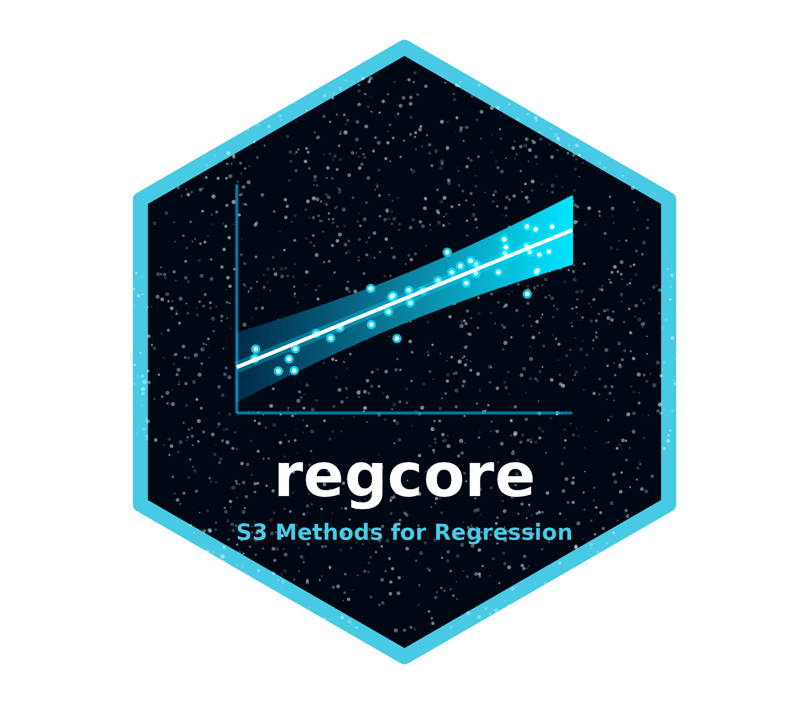

# regcore: S3 Generic Methods for Regression Models 

<!-- badges: start -->
[](https://github.com/rpetterle/regcore/actions/workflows/R-CMD-check.yaml)
<!-- badges: end -->

The **regcore** package defines S3 generic methods used by regression packages to provide model comparison, coefficient summaries, goodness-of-fit tables, diagnostics, random-effects summaries, and methods reporting. It does **not** fit regression models or implement statistical tests by itself. Class-specific methods are defined by packages that extend these interfaces.

## Available generics

| Purpose | Functions |
| --- | --- |
| Model comparison and selection | `vuong_test()`, `pairwise_vuong_test()`, `stepCriterion()` |
| Model summaries | `summary_coef()`, `extract_equations()`, `random_effects()` |
| Goodness-of-fit and diagnostics | `gof_tab()`, `plot_envelope()`, `df_envelopes()`, `plot_ranef()` |
| Methods reporting | `write_methods()` |

## Installation

```r
install.packages("remotes")
remotes::install_github("rpetterle/regcore")
```

## Implementing an S3 method

A downstream package can implement a method for the corresponding fitted-model class. For illustration, this example defines a temporary method using base R only:

```r
library(regcore)
fit <- structure(list(aic = 12.5), class = "demo_regression")
gof_tab.demo_regression <- function(object, ...) data.frame(AIC = object$aic)
gof_tab(fit)
```

In a package that imports `regcore`, register the methods through the downstream package's own `NAMESPACE` (for example by using roxygen2 `@export` on the class-specific method). Refer to each generic's help page with `?gof_tab` or `?summary_coef`.

## License

GPL (>= 3).
